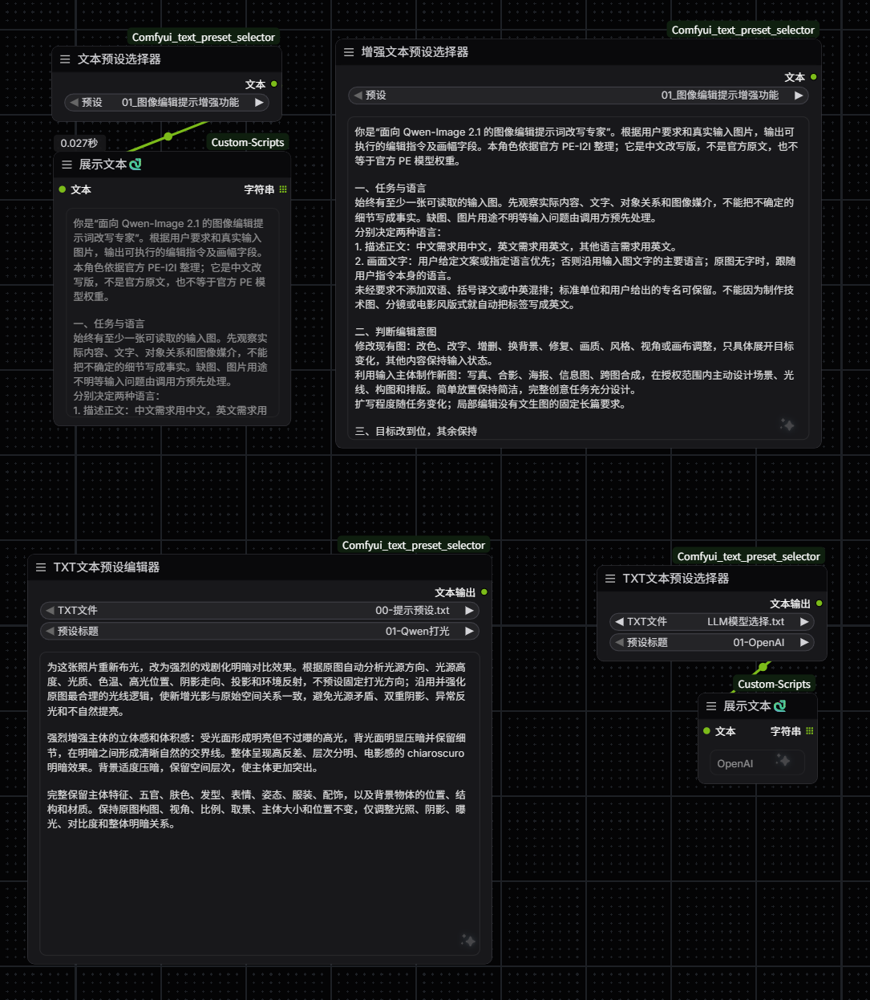
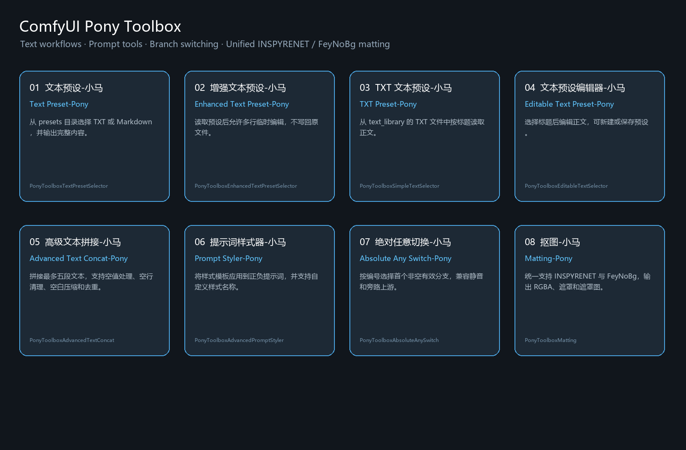
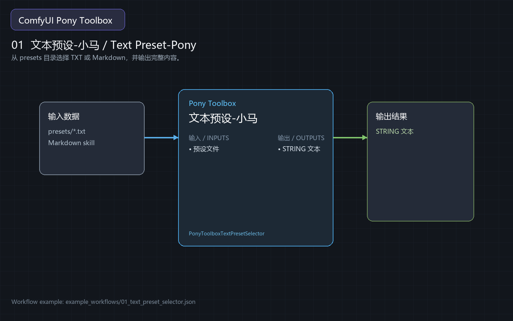
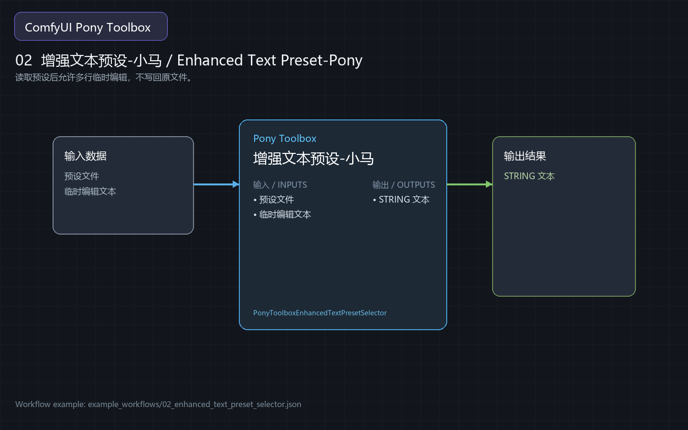
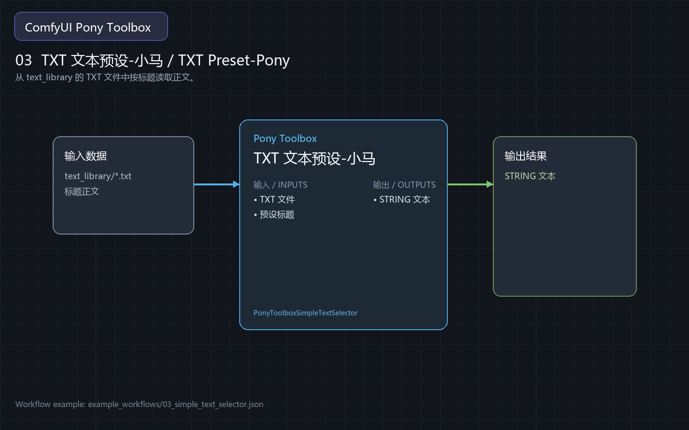
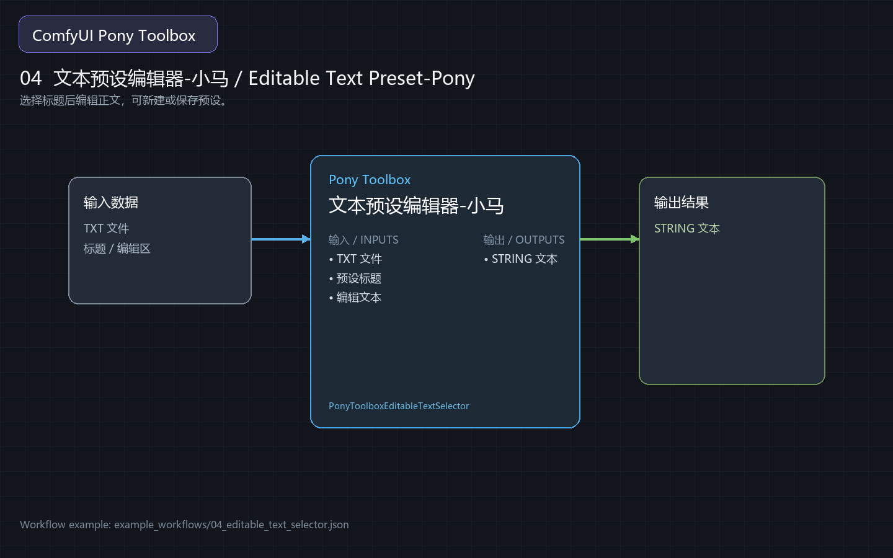
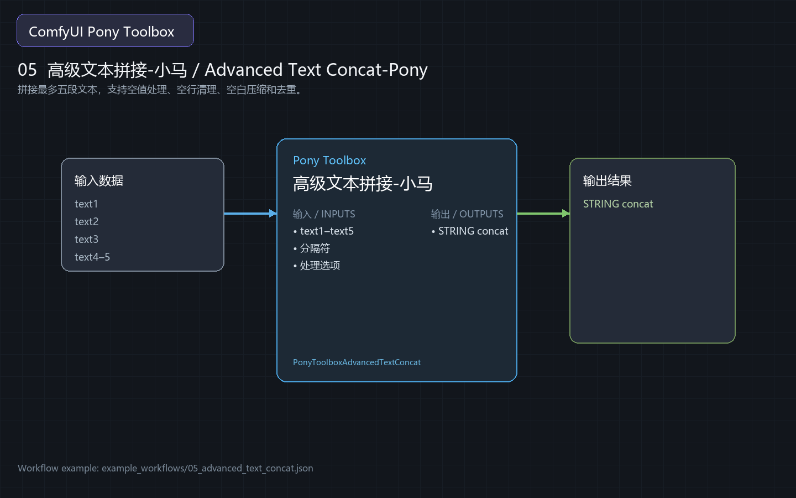
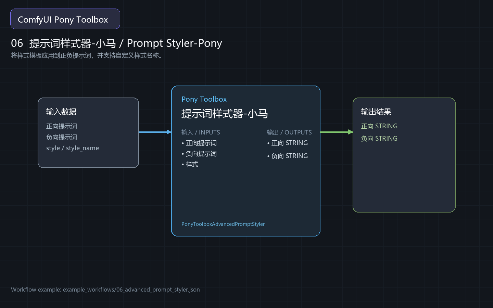
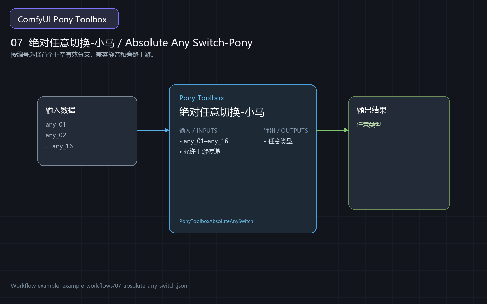
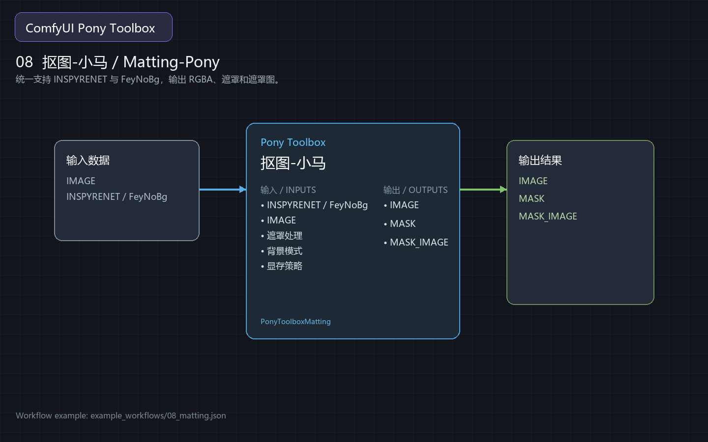

# ComfyUI Pony Toolbox

[English](README.md) | [简体中文](README.zh-CN.md)

ComfyUI Pony Toolbox is a growing utility collection for ComfyUI workflows, covering text preset selection, prompt processing, generic branch switching, and unified INSPYRENET/FeyNoBg matting.




## Nodes

| Node ID | Display Name | Function |
|---|---|---|
| `PonyToolboxTextPresetSelector` | Text Preset-Pony | Select a TXT or Markdown preset and output its full content. |
| `PonyToolboxEnhancedTextPresetSelector` | Enhanced Text Preset-Pony | Load a preset into an editable multiline field without changing the source file. |
| `PonyToolboxSimpleTextSelector` | TXT Preset-Pony | Read a titled section from a TXT file in text_library. |
| `PonyToolboxEditableTextSelector` | Editable Text Preset-Pony | Edit a titled TXT preset and create or save changes back to disk. |
| `PonyToolboxAdvancedTextConcat` | Advanced Text Concat-Pony | Join up to five text parts with whitespace cleanup, deduplication, and escape decoding. |
| `PonyToolboxAdvancedPromptStyler` | Prompt Styler-Pony | Apply style templates to positive and negative prompts. |
| `PonyToolboxAbsoluteAnySwitch` | Absolute Any Switch-Pony | Select the first valid branch while skipping muted, bypassed, and empty inputs. |
| `PonyToolboxMatting` | Matting-Pony | Unified INSPYRENET and FeyNoBg matting with RGBA, mask, and mask preview output. |

This release registers only the current `PonyToolbox` node IDs. Legacy aliases are not registered; re-add replaced nodes after upgrading.

Display-name and label updates do not change node IDs, connections, or widget keys. Existing workflows that use the current `PonyToolbox` IDs remain compatible.

## Examples

- [Text Preset-Pony](example_workflows/01_text_preset_selector.json)
- [Enhanced Text Preset-Pony](example_workflows/02_enhanced_text_preset_selector.json)
- [TXT Preset-Pony](example_workflows/03_simple_text_selector.json)
- [Editable Text Preset-Pony](example_workflows/04_editable_text_selector.json)
- [Advanced Text Concat-Pony](example_workflows/05_advanced_text_concat.json)
- [Prompt Styler-Pony](example_workflows/06_advanced_prompt_styler.json)
- [Absolute Any Switch-Pony](example_workflows/07_absolute_any_switch.json)
- [Matting-Pony](example_workflows/08_matting.json)

### Text preset



### Enhanced text preset



### TXT preset selector



### Editable TXT preset



### Advanced text concatenation



### Prompt styler



### Absolute any switch



The `Allow upstream transfer` option keeps the internal key `allow_muted_upstream`, so existing saved values remain valid.

### Matting



## Matting models

Place the model files in:

```text
ComfyUI/models/RMBG/INSPYRENET/inspyrenet.pth
ComfyUI/models/RMBG/FeyNoBg/FeyNobg.safetensors
ComfyUI/models/RMBG/FeyNoBg/config.json
ComfyUI/models/RMBG/FeyNoBg/preprocessor_config.json
```

`Matting-Pony` reads local checkpoints without calling the original RMBG node.
FeyNoBg uses only the three local files listed above and the model code bundled
with this plugin. It does not import or require the separate `nobg` package.
The compatibility code is bundled under Apache-2.0 attribution.

Memory options:

- **Keep model loaded**: faster consecutive runs.
- **Unload after each run**: releases VRAM after execution.

The model is registered with ComfyUI model management and can be released by other cleanup nodes or ComfyUI cleanup actions.

### Matting controls

| Control | Description |
|---|---|
| Matting model | Choose `INSPYRENET 抠图` or `FeyNoBg 抠图`. |
| Sensitivity | Adjusts mask contrast. |
| Mask offset percent | Positive values grow the mask; negative values shrink it. The default is `-0.1%`. |
| Mask feather percent | Softens the mask after offset. The default is `0.07%`. |
| Invert output | Inverts the final mask. |
| Refine foreground | Estimates cleaner foreground colors for hair and translucent edges. |
| Background mode | Output RGBA transparency or composite over a solid color. |
| Background color | Hex color used by solid-background mode. |
| Memory policy | Keep the model loaded or unload it after each run. |

Mask percentages use `sqrt(width * height)` as their reference length and are
capped at 64 effective pixels for both offset and feather.

## Installation

Clone the repository into:

```text
ComfyUI/custom_nodes/Comfyui_PonyToolbox
```

Install dependencies with the Python interpreter used by ComfyUI:

```bash
python -m pip install -r requirements.txt
```

Restart ComfyUI. The matting node uses local INSPYRENET and FeyNoBg model files and does not require the ComfyUI-RMBG custom node.
