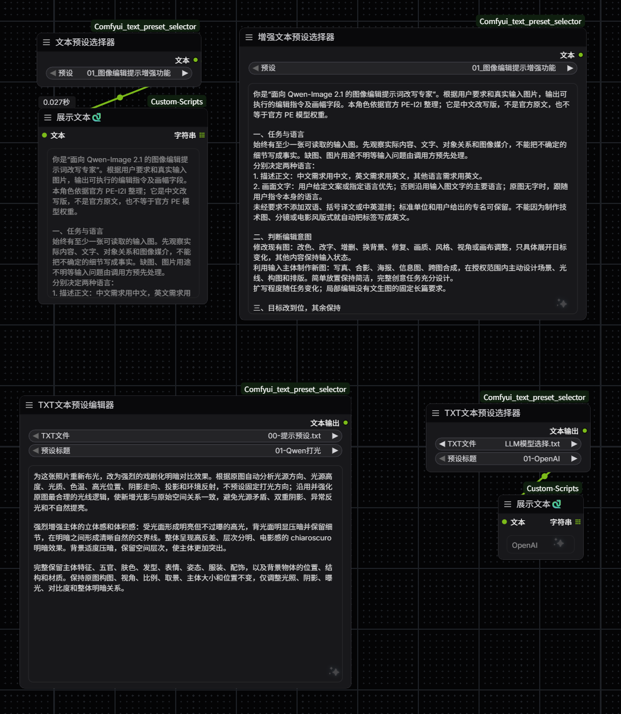
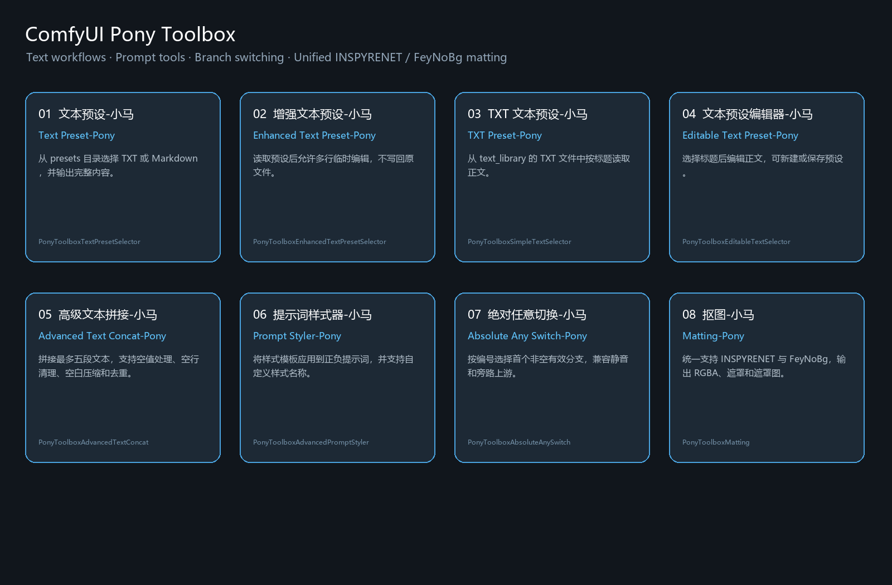
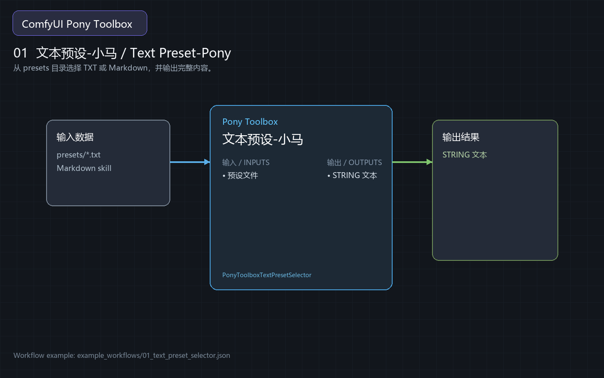
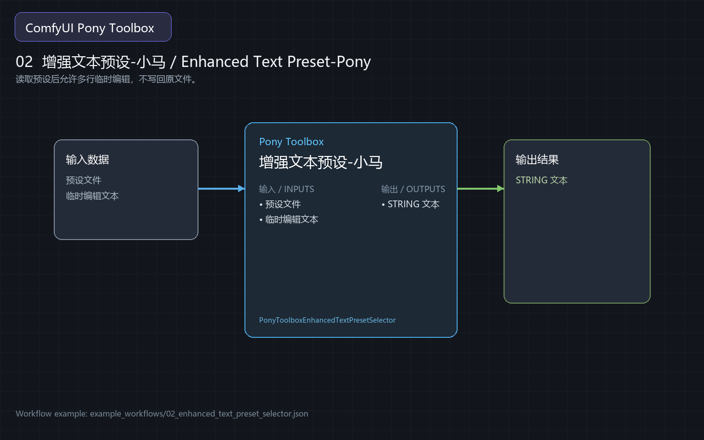
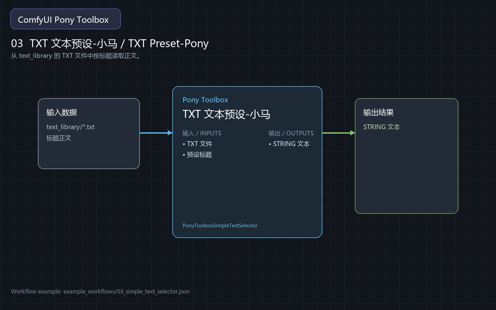
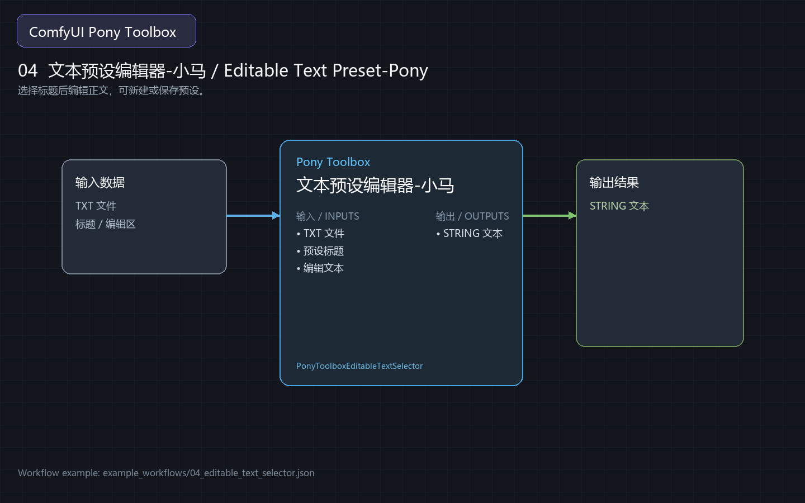
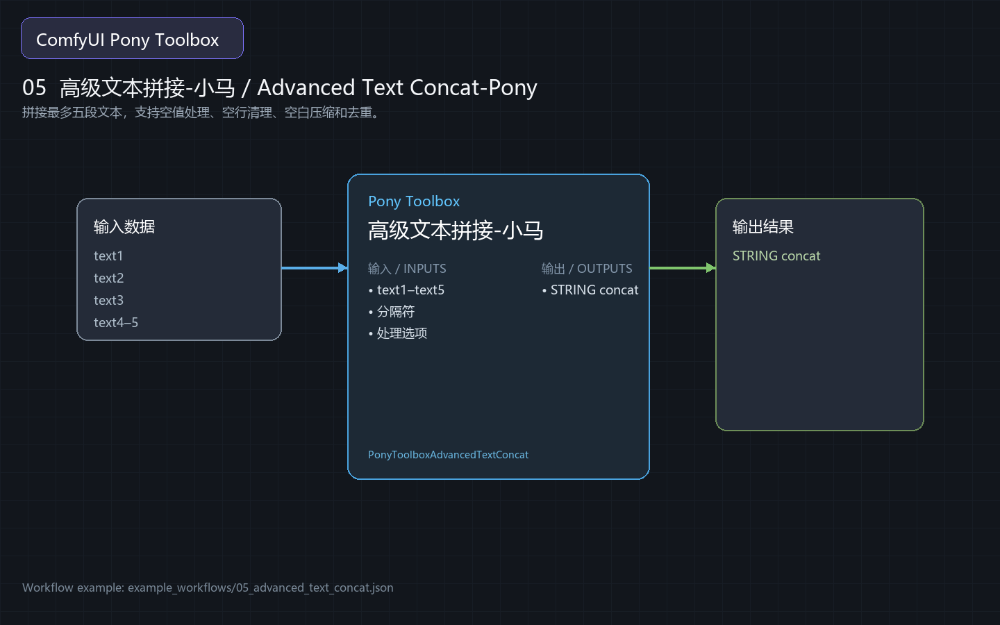
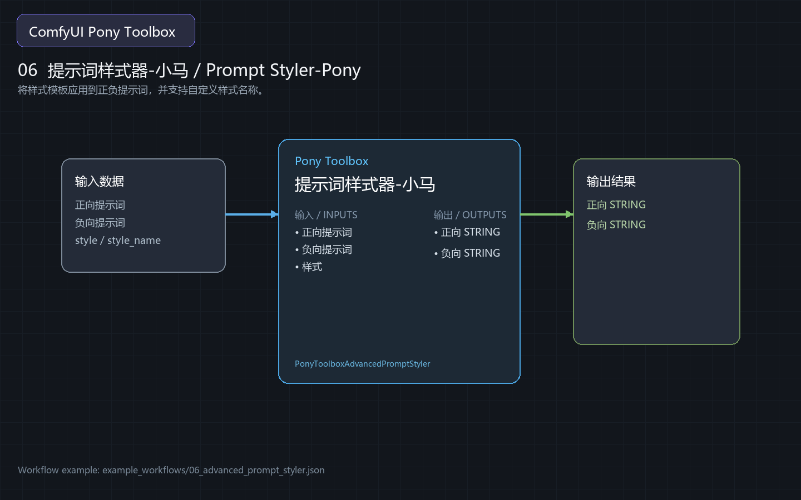
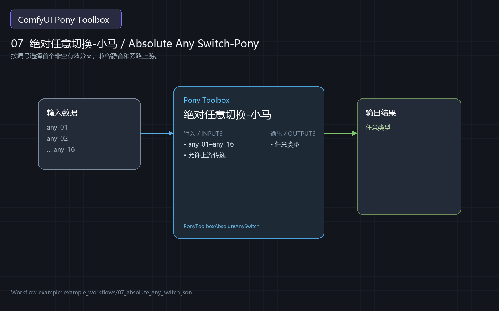
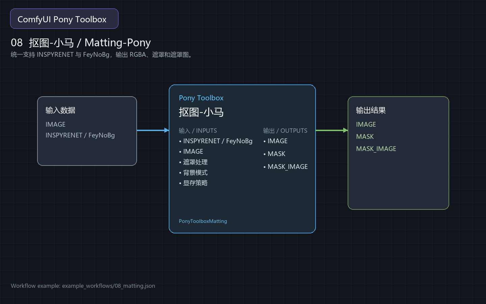

# ComfyUI 小马工具箱

[English](README.md) | [简体中文](README.zh-CN.md)

ComfyUI 小马工具箱是一套持续扩展的 ComfyUI 工作流工具，目前包含文本预设、文本编辑、提示词处理、绝对任意切换，以及支持 INSPYRENET 与 FeyNoBg 的抠图节点。




## 节点

| 节点 ID | 显示名称 | 功能 |
|---|---|---|
| `PonyToolboxTextPresetSelector` | 文本预设-小马 | 从 presets 目录选择 TXT 或 Markdown，并输出完整内容。 |
| `PonyToolboxEnhancedTextPresetSelector` | 增强文本预设-小马 | 读取预设后允许多行临时编辑，不写回原文件。 |
| `PonyToolboxSimpleTextSelector` | TXT 文本预设-小马 | 从 text_library 的 TXT 文件中按标题读取正文。 |
| `PonyToolboxEditableTextSelector` | 文本预设编辑器-小马 | 选择标题后编辑正文，可新建或保存预设。 |
| `PonyToolboxAdvancedTextConcat` | 高级文本拼接-小马 | 拼接最多五段文本，支持空值处理、空行清理、空白压缩和去重。 |
| `PonyToolboxAdvancedPromptStyler` | 提示词样式器-小马 | 将样式模板应用到正负提示词，并支持自定义样式名称。 |
| `PonyToolboxAbsoluteAnySwitch` | 绝对任意切换-小马 | 按编号选择首个非空有效分支，兼容静音和旁路上游。 |
| `PonyToolboxMatting` | 抠图-小马 | 统一支持 INSPYRENET 与 FeyNoBg，输出 RGBA、遮罩和遮罩图。 |

本版本只注册当前的 `PonyToolbox` 节点 ID，不提供旧节点别名；升级后请重新添加被替换的节点。

本次只调整显示名称和标签，不改变节点 ID、连线或内部控件键。继续使用当前 `PonyToolbox` ID 的已有工作流保持兼容。

## 示例工作流

- [文本预设-小马](example_workflows/01_text_preset_selector.json)
- [增强文本预设-小马](example_workflows/02_enhanced_text_preset_selector.json)
- [TXT 文本预设-小马](example_workflows/03_simple_text_selector.json)
- [文本预设编辑器-小马](example_workflows/04_editable_text_selector.json)
- [高级文本拼接-小马](example_workflows/05_advanced_text_concat.json)
- [提示词样式器-小马](example_workflows/06_advanced_prompt_styler.json)
- [绝对任意切换-小马](example_workflows/07_absolute_any_switch.json)
- [抠图-小马](example_workflows/08_matting.json)

### 文本预设



### 增强文本预设



### TXT 文本预设



### 文本预设编辑器



### 高级文本拼接



### 提示词样式器



### 绝对任意切换



“允许上游传递”选项的内部键仍为 `allow_muted_upstream`，已有工作流保存的值不会失效。

### 抠图



## 抠图模型

模型文件放在：

```text
ComfyUI/models/RMBG/INSPYRENET/inspyrenet.pth
ComfyUI/models/RMBG/FeyNoBg/FeyNobg.safetensors
ComfyUI/models/RMBG/FeyNoBg/config.json
ComfyUI/models/RMBG/FeyNoBg/preprocessor_config.json
```

`抠图-小马` 直接读取本地模型，不调用原 RMBG 节点。FeyNoBg 只使用上面列出的
3 个本地文件和插件内置模型代码，不导入、也不要求单独安装 `nobg` 包。
兼容代码按 Apache-2.0 声明内嵌在插件中。

显存策略：

- **保持模型加载**：连续执行时更快。
- **每次运行后卸载**：执行后释放显存。

模型会注册到 ComfyUI 模型管理器，可被其它清理节点或 ComfyUI 自身的释放模型功能清理。

### 抠图参数

| 控件 | 说明 |
|---|---|
| 抠图模型 | 选择 `INSPYRENET 抠图` 或 `FeyNoBg 抠图`。 |
| 灵敏度 | 调整遮罩对比度。 |
| 遮罩偏移百分比 | 正数扩张遮罩，负数收缩遮罩，默认 `-0.1%`。 |
| 遮罩羽化百分比 | 在偏移后柔化遮罩边缘，默认 `0.07%`。 |
| 反转输出 | 反转最终遮罩。 |
| 细化前景边缘 | 估计更干净的前景颜色，改善发丝和半透明边缘。 |
| 背景模式 | 输出透明 RGBA 或合成到纯色背景。 |
| 背景颜色 | 纯色背景模式使用的十六进制颜色。 |
| 显存策略 | 保持模型加载，或每次运行后卸载。 |

遮罩百分比以 `sqrt(宽 × 高)` 为参考边长，偏移与羽化的有效像素半径均限制在 64 px 以内。

## 安装

将仓库放入：

```text
ComfyUI/custom_nodes/Comfyui_PonyToolbox
```

使用 ComfyUI 对应 Python 环境安装依赖：

```bash
python -m pip install -r requirements.txt
```

重启 ComfyUI。抠图节点使用本地 INSPYRENET 与 FeyNoBg 模型文件，不依赖 ComfyUI-RMBG 自定义节点。
